<picture>
  <source media="(prefers-color-scheme: dark)" srcset="assets/header-dark.svg">
  
</picture>

Analista de TI no interior do Ceará. Trabalho com provedores de internet e projetos freelance, cuidando da infraestrutura, automatizando a operação e construindo os sistemas que o negócio usa no dia a dia.

Meu ponto forte é pegar um processo manual que trava a operação e transformar em algo que roda sozinho, do servidor até a tela do atendente.

### O que eu construo

<b>🤖 Automação de atendimento com IA</b> — bots em n8n conectados ao WhatsApp e ao ERP

 

Agente comercial que conversa com leads, pontuação de risco de cancelamento (churn) e agendamento automático de ordens de serviço para técnicos de campo.

`n8n` `WhatsApp Cloud API` `agentes de IA` `ERP`

<b>💬 Plataforma de atendimento omnichannel</b> — todos os canais em uma só fila

 

Central self-hosted baseada em Chatwoot, com integrações de WhatsApp via API oficial e não oficial. Hoje é comercializada para outras empresas.

`Chatwoot` `Supabase` `Node.js` `Docker Swarm` `Traefik`

<b>📊 Plataforma SaaS de indicadores</b> — KPIs de atendimento para gestores

 

Sistema multi-tenant com indicadores como tempo médio de espera e desempenho por equipe, para gestores acompanharem a operação.

`Node.js` `React` `PostgreSQL` `GitHub Actions` `Docker Swarm`

<b>🔌 Ferramentas de IA para o ERP</b> — agentes operando o sistema do provedor

 

Nós e ferramentas para que agentes de IA consultem e operem o ERP do provedor direto de dentro das automações.

`n8n` `community nodes` `ferramentas de IA`

<b>🛠️ Assistente de campo</b> — o técnico conversa com uma IA no celular

 

Protótipo de app em que o técnico pede para a IA provisionar o equipamento do cliente e recebe um resumo do atendimento antes de chegar ao local.

`IA` `GenieACS / TR-069` `ERP`

### Infraestrutura que mantenho

- Cluster de virtualização **Proxmox** em servidores Dell, incluindo recuperação após falha de sistema
- Serviços em **Docker Swarm** atrás de **Traefik**, migrados de Nginx
- **GitLab** self-hosted com pipelines de CI/CD
- Gerência remota de roteadores de clientes via **GenieACS / TR-069**
- Rede **MikroTik** e monitoramento com **Zabbix**

### Ferramentas

<picture>
  <source media="(prefers-color-scheme: dark)" srcset="assets/stack-dark.svg">
  
</picture>

### Atividade

<picture>
  <source media="(prefers-color-scheme: dark)" srcset="https://raw.githubusercontent.com/pvictor961/pvictor961/output/github-snake-dark.svg">
  
</picture>

### Contato

Aberto a projetos de **automação com n8n**, **atendimento via WhatsApp** e **infraestrutura para provedores**.

